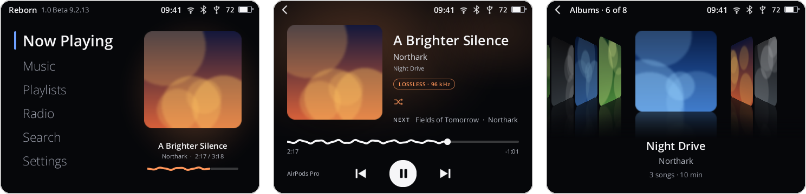
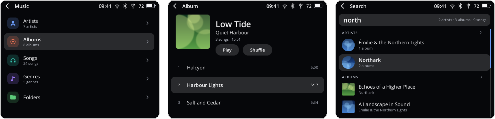
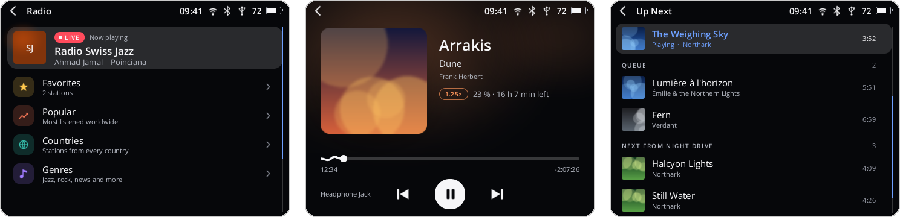
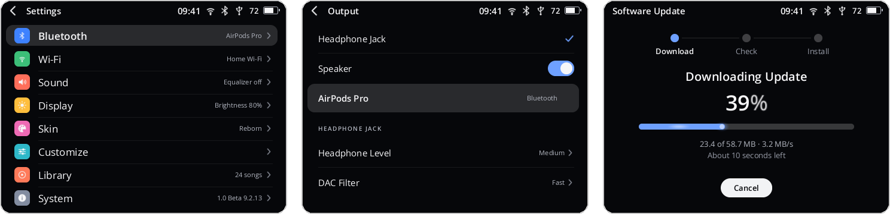
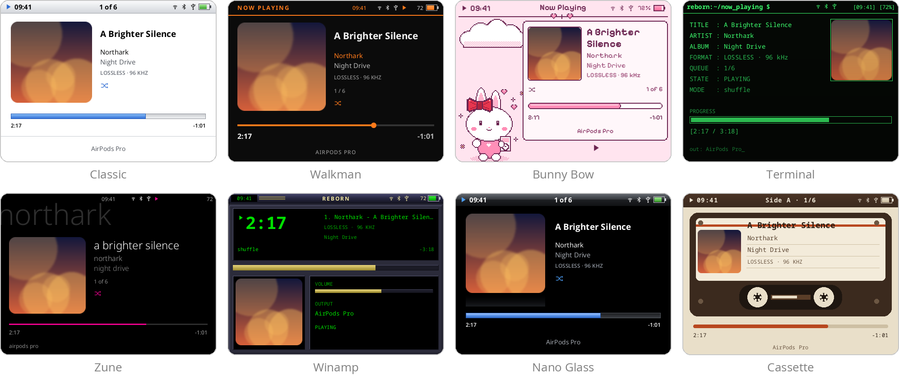

# Y2Linux

**A new life for the Innioasis Y2.** Y2Linux replaces the player's stock Android system with a small, fast Linux
system built only for music, and with [Reborn](https://github.com/SchulzCode/Y2Reborn), a music player made for the
Y2's click wheel. Cover Flow, gapless playback, Bluetooth headphones with AAC and LDAC, internet radio, audiobooks,
Last.fm and seventeen skins. Once it's installed, the player updates itself over Wi-Fi.

  

> **Current version: Y2Linux 1.0 Beta 9.3.23** (10 November 2026), a public beta.
> **[Download it from the releases page](https://github.com/SchulzCode/Y2Linux/releases/latest)** and follow the
> [install guide](docs/INSTALL.md). It runs every day on the developer's Y2 and on many others, but it is still a
> beta: read [Known issues](#known-issues) first.

## What you get

**Your music, the way you like to find it**
- Artists, albums, songs, genres and folders, from the player's 5.4 GB Internal Storage and a microSD card
  (FAT32, exFAT or ext4). Libraries of 120 000 songs stay quick.
- Albums in **Cover Flow** or as a grid, covers from the album folder or from the file.
- **Search** that shows results while you type, across artists, albums, songs and playlists.
- **Up Next**: a play queue you can edit (Play Next, Add to Queue, move, remove) with the songs you heard before.
- **Playlists** made on the player or copied from a computer (`.m3u`/`.m3u8`), and a Favorites list with a heart.
- Japanese, Chinese and Korean titles shown properly.

**Sound**
- FLAC, ALAC, MP3, AAC/M4A, Opus, Ogg Vorbis, WAV, AIFF, APE and WavPack; gapless playback and crossfade. Files in
  other formats (WMA, DSD, …) are not added; Settings → Library says how many were left out.
- A five-band equalizer with presets, **profiles for 47 popular headphones and IEMs** (AutoEq) and your own
  AutoEq files, Normalize Volume (ReplayGain), left/right balance, three headphone levels and the DAC's filters.
- The internal speaker plays when no headphones are plugged in; plugging them in moves the music to them.

**Wireless**
- **Bluetooth headphones** with SBC and AAC chosen automatically (LDAC when you pick it), at steady rates that leave
  room for Wi-Fi; they come back after sleep by themselves, Bluetooth repairs itself when a step fails, and the
  player's volume controls theirs.
- **Internet radio** from the free radio-browser.info directory (popular, by country, by genre, search), favorites
  and your own station lists.
- **Last.fm scrobbling**: sign in by scanning a QR code with your phone; plays wait on the player while offline.

**Audiobooks**
- A place of their own on Home: the player remembers your spot in every book, moves by chapter, plays each book at
  its own speed (0.75–2×) and has a sleep timer. Books stay out of your music shuffle.

**Make it yours**
- **Seventeen skins**, from Classic to Walkman, Winamp, Bunny Bow and Luna XP, and more you can copy onto the player.
- Choose what Home shows and in which order, Cover Flow on or off, lists that wrap around, what the wheel does on
  Now Playing, a wheel click, haptic ticks and what the buttons do while the screen is off.

**Everyday**
- Copy music over USB (MTP) from Windows, macOS or Linux at about 30 MB/s; the player charges at the same time.
- **Quick Menu**: hold Power on any screen for Wi-Fi, Bluetooth, brightness, the sleep timer, Restart and Power Off.
- Deep sleep when the screen turns off, waking with Power in about half a second; a clock that sets its time zone
  by itself.
- **Updates over Wi-Fi** (Settings → System → Software Update). Each one checks itself and goes back to the
  previous version on its own if anything fails; **Restore Previous System** brings back the version you had.
- Optional **error reports**: if something goes wrong, the player can send its logs, with personal data removed,
  so the problem can be found ([how it works](docs/ERROR-REPORTS.md)).

## A look around

  
   <em>Music, an album and live search</em>

  
   <em>Internet radio, an audiobook and Up Next</em>

  
   <em>Settings, where the sound goes, and an update over Wi-Fi</em>

  
   <em>Now Playing in eight of the seventeen skins</em>

*The pictures are drawn by Reborn's own drawing code with sample music (Beta 9.2.13).*

## Install

You need a computer (Windows or Linux) with SP Flash Tool v5.2032, a USB cable, the Y2Linux first-install package from the
[latest release](https://github.com/SchulzCode/Y2Linux/releases/latest) and the **Innioasis Y2 firmware package
v3.2.0** from Innioasis (it is also your way back to stock).

1. Flash the Y2Linux package once with SP Flash Tool (*Download Only*).
2. Start the player: it sets up its storage, then Reborn starts and music plays.
3. Copy `system.img` from the Innioasis package into the player's **Firmware** folder over USB. The player takes
   its Wi-Fi and Bluetooth firmware from it; Y2Linux itself contains none of MediaTek's firmware.
4. Copy your music onto the player.

Every step in detail: **[Install guide](docs/INSTALL.md)**. After that, updates come over
Wi-Fi ([how updates work](docs/RECOVERY-AND-UPDATES.md)). More guides: [Storage](docs/STORAGE.md) ·
[Audiobooks](docs/AUDIOBOOKS.md) · [Headphone output](docs/HEADPHONE-OUTPUT.md) · [Last.fm](docs/LASTFM.md) ·
[Error reports](docs/ERROR-REPORTS.md) · [Making skins](https://github.com/SchulzCode/Y2Reborn/blob/main/docs/skins.md)

## Known issues

- **Tested hardware.** One hardware revision has been tested closely (see [Supported hardware](#supported-hardware));
  both screen types the Y2 ships with (GC9503V and ST7701S) are supported.
- **Battery life in sleep** is about 2 mA overnight on the developer's player (estimated from the battery voltage);
  stock is about 1.3 mA.
- **Some players turned off by themselves during playback.** The cause is not found yet. If yours does, start it
  again and send an error report.
- **Bluetooth after a long pause:** with AirPods Pro, a pause longer than about 20 seconds drops the connection once;
  they reconnect within seconds, but pressing play during those 20 seconds can stay silent until they are back.
- **The speaker** uses the same volume as the headphones; its loudest step is the stock speaker's. Start low the
  first time.
- **Radio:** stations that stream only in HLS (such as the BBC) don't play yet. FM radio is planned for a later beta.
- **Going back to stock** doesn't restore the old storage format: copy your music off first; stock Android then has
  to format that storage ([Storage](docs/STORAGE.md)).

If something doesn't work, please [open an issue](https://github.com/SchulzCode/Y2Linux/issues) and send an error
report (Settings → System → Error Reports). The full technical list is in the
[current platform state](docs/CURRENT_PLATFORM_STATE.md), and every release has a plain-language report in
[docs/validation](docs/DOCUMENTATION_CATALOG.md).

## Supported hardware

The Innioasis Y2 (board `eastaeon82_wet_kk`, MediaTek MT6582, 7.8 GB eMMC) as shipped with Innioasis firmware
**v3.2.0 FM (2026-08-13)**. Y2Linux replaces Android on the internal storage and leaves the bootloaders,
calibration and factory partitions untouched. A Y2 with a different board, storage size or partition table is
**not supported** until someone verifies it; please report your player's details in an issue.

## For developers

| | 1.0 Beta 9.3.23 (Baseline 234) |
| --- | --- |
| Git tag (both repositories) | `baseline-234` (previous: `baseline-233`); the GitHub release carries the first-install images, the signed over-the-air update and the GPL sources |
| Release / kernel | `1.0.0-beta.9.3.23` / `6.18.56-y2linux-1.0.0-beta.9.3.23` (Linux 6.18 long-term line) |
| Root filesystem | `2026.08-platform-v1.257` (Buildroot 2026.08) |
| Platform | `y2-platform` (Rust 1.99): the battery, sleep, Wi-Fi, Bluetooth, storage, update, USB and report services; no Python on the player |
| Player | Y2Reborn 1.0.0-beta.9.3.23 (Rust 1.99, OpenGL ES on the Mali-400 GPU through DRM + Lima, FFmpeg, SQLite) |
| Bluetooth codecs | SBC, AAC (fdk-aac-free) and LDAC |
| Main components | GCC 15.3 / glibc 2.44, Mesa 26.2.4, FFmpeg 9.0.2, BlueZ 5.87, OpenSSL 4.0.3 |
| Images built from | Y2Linux `8f357e92`, Y2Reborn `9930022` ([Beta 9.3.23 report](docs/validation/Y2-LINUX-1.0-BETA-9.3.23.md); every earlier release report is listed in the [documentation catalog](docs/DOCUMENTATION_CATALOG.md)) |

- **[Build from source](docs/BUILDING.md)**: host setup, the build, the first-install package and releases.
- **[Coding standard](docs/CODING-STANDARD.md)** for the platform and Reborn; `tools/development/platform-gate.sh`
  must print `GATE OK` before every commit.
- Documentation starts at [docs/README.md](docs/README.md).

| Path | Contents |
| --- | --- |
| `kernel/` | Kernel configuration, device tree, platform drivers (`kernel/platform`, `kernel/usb`, `kernel/audio`) and the overlay patches applied to Linux 6.18 (`kernel/patches`) |
| `buildroot/` | Buildroot external tree: defconfig, board overlays, local packages (Reborn, connectivity, MTP, updater) |
| `initramfs/` | Boot-time rescue and handover to the internal root filesystem |
| `platform/` | `y2-platform`, the on-device platform service and CLI (Rust; [CONTRACT.md](platform/CONTRACT.md)) |
| `tools/build/` | Locked, network-isolated kernel build environment (bubblewrap) |
| `tools/production/` | Production build, packaging, validation and releases |
| `tools/host/` | Tools for the owner's or a tester's computer (transfer, diagnostics, qualification, audio fixtures) |
| `tools/connectivity/` | Wi-Fi/Bluetooth services and stock firmware provisioning |
| `tests/` | Host and container test suites (`tools/production/tests.sh`) |
| `docs/` | Documentation |

## Licence

Each source file carries its own SPDX licence identifier; the kernel drivers and patches are GPL-2.0, and Y2Reborn
is MIT. Each release carries the corresponding sources of the packages in its images (Buildroot legal-info and the
Linux archive). The proprietary MediaTek radio firmware is **not** in this repository or in any image: each player
takes it from its owner's copy of the Innioasis firmware package
([why](docs/INSTALL.md#why-the-innioasis-package)).

This project is not affiliated with Innioasis or MediaTek. Flashing replaces the stock system; you do it at your
own risk.
