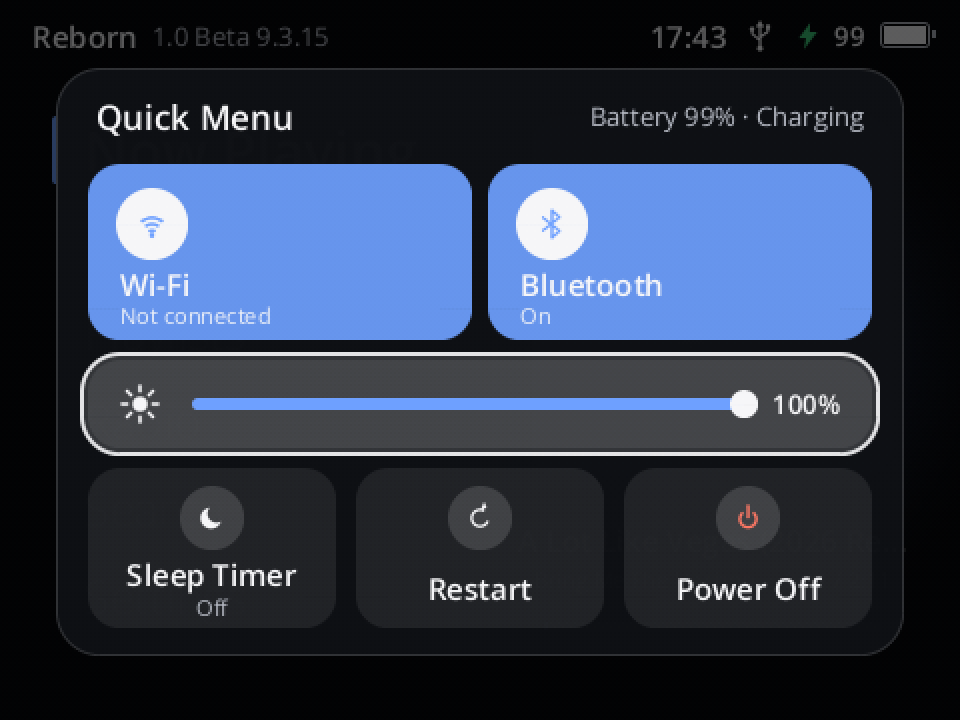

# Y2Linux 1.0 Beta 9.3.15: the Quick Menu

Release `1.0.0-beta.9.3.15`, Y2Reborn `1.0.0-beta.9.3.15`, kernel `6.18.56-y2linux-1.0.0-beta.9.3.15`, update
sequence 14800, root `2026.08-platform-v1.246`. Published as GitHub release `baseline-223` (test build 223). Previous
release: [Beta 9.3.13](Y2-LINUX-1.0-BETA-9.3.13.md). Version 9.3.14 (test build 222) was the same menu as a plain
list on the developer's player and was never published.

This report is written for people who use the player. A short technical appendix is at the end.

  
   <em>The Quick Menu on the player (screenshot of test build 223)</em>

## In one paragraph

**Hold Power on any screen and the Quick Menu opens** (Y2Linux #85): Wi-Fi and Bluetooth on or off, the screen's
brightness, the sleep timer, Restart and Power Off, without walking into Settings. It is a panel of tiles in the
middle of the screen that grows in over the dimmed screen; the focus glides from tile to tile as you turn the
wheel. Holding Power still turns the player off: keep holding and a ring fills around the Power Off tile.

## How to use it

- **Hold Power** (about two thirds of a second) on any screen, also with the screen off. Let go: the menu stays.
- **Turn the wheel** to move: Wi-Fi → Bluetooth → Brightness → Sleep Timer → Restart → Power Off. It opens on
  Brightness.
- **Wi-Fi / Bluetooth:** Select switches it on or off; the tile is coloured while it is on and names the network
  or the headphones.
- **Brightness:** Select, turn the wheel (the screen follows), Select again.
- **Sleep Timer:** opens the timer's choices. **Restart** and **Power Off** act at once (not while an update
  installs).
- **Close** with Back or a short press of Power.
- **Turn off without looking:** keep holding Power. After 3 s a ring fills around Power Off and the player turns off
  1.2 s later. Holding Power for 10 s still resets a player that does not answer at all.

Every skin shows the same panel in its own colours. Everything in the menu is also where it always was in Settings.

## How it was tested

- **Before release:** the platform's full check, Reborn's workspace tests (new tests: the hold opens the menu,
  release keeps it, a short press closes it, a long hold turns the player off once, the keyboard keeps the old
  ring; the tiles' order and values, the switches, brightness, the sleep timer, Restart and Power Off waiting while
  an update runs) and the 552 tests of the release images.
- **Pictures:** the panel, brightness adjusting and the ring were checked on host renders in Reborn's own look and
  in Bunny Bow, Terminal and Classic (Terminal's lit tiles needed dark text).
- **On a player:** test build 223 on the developer's player: installed by update, the menu opened from Home by a
  hold and closed again; the screenshot above is from the player.

## Updating

Settings → System → Software Update → **Update Now**. Your music, playlists, settings, Wi-Fi networks and Bluetooth
pairings stay. **Restore Previous System** (Settings → System → About, tap Version seven times, then Diagnostics) goes
back to the version you had.

## Known issues

Everything listed for [Beta 9.0](Y2-LINUX-1.0-BETA-9.0.md#known-issues-and-what-still-needs-your-help) and
[Beta 9.3.13](Y2-LINUX-1.0-BETA-9.3.13.md#known-issues) still applies.

- Back in the sleep timer's choices closes the menu instead of returning to it.
- If you were used to holding Power to turn the player off, it now takes about 4 s instead of 2 s (or pick Power Off).

## Technical appendix

- Reborn `crates/reborn-ui/src/quick_menu.rs` (`power_held`, rows, actions, `close_quick_menu`; `QUICK_MENU_HOLD` 3 s)
  and `views_quick.rs` (the panel: `ui.motion.ease` springs `quick.*` for the grow-in, the focus frame, the tiles'
  fill and the brightness level; fade-out after closing; the hold ring on the Power Off tile; skins draw it remapped
  to their palette). `Modal::QuickMenu` is not saved with the session. `power_hold` is now the instant the ring
  starts. Brightness reuses the Display card's `adjusting_brightness`.
- The input layer is unchanged: Power's long press is still `PowerHold`, its release `PowerHoldCancel`.
- Linux `e9bcdee5` (built), Reborn `e2555d2` (built); work commits Reborn `f78c7ae`, `0df540a`, Linux
  `507d60c9`. Settings map: Reborn `docs/ui/REBORN-SETTINGS-MAP.md` "The Quick Menu (hold Power)".
